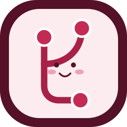

<div align="center">


# 🍒 Raidian · 레이디안

### Git이 어렵게 느껴지는 날에도, 루비는 옆에 있어요. ♡

**Electron 하나로 GUI · CLI · MCP** — 버건디와 체리 레드의 작은 Git 작업실.

   

[🌷 시작하기](#-시작은-간단하게) · [🧁 무엇을 할 수 있나요](#-루비의-git-메뉴판) · [🤖 CLI와 MCP](#-사람도-에이전트도-환영) · [🪟 Windows 빌드](#-윈도우-포터블-exe) · [📚 설명서](#-도움이-필요하면)
</div>

---

## 🌷 시작은 간단하게

**준비:** Node.js 22 이상, Git for Windows(또는 Git), 그리고 GitHub PR을 사용할 때만 GitHub CLI(`gh`). Electron 설치 없이 **완성된 EXE를 실행하면** Node 설치가 필요하지 않아요. Git과 선택적인 gh는 별도로 필요합니다.

```powershell
git clone https://github.com/hslcrb/Raidian.git
cd Raidian
npm install
npm start
```

> ⚠️ EXE가 실제 배포되었는지는 [Releases](https://github.com/hslcrb/Raidian/releases)에서 확인하세요. 소스에 빌드 스크립트가 있다는 뜻이 EXE를 만들어 게시했다는 뜻은 아니에요.

프로그램을 열었다면 **폴더 열기 → 변경 파일 확인 → 커밋 → 푸시**. 이것만 해도 충분해요. 💌

| 용어 | 쉬운 뜻 |
| :-- | :-- |
| **커밋** | 내 컴퓨터에 변경 사항을 기록해요. |
| **푸시** | 기록을 GitHub 같은 원격 저장소로 올려요. |
| **풀** | 원격의 변경을 내 브랜치에 가져와 병합해요. |
| **브랜치** | 작업 흐름을 나누는 별도의 가지예요. |
| **no-ff** | 서로 다른 가지가 만난 순간을 병합 커밋으로 남겨요. |

## 🧁 루비의 Git 메뉴판

| 메뉴 | 실제 하는 일 |
| :-- | :-- |
| 🍓 변경 파일 | 한글 파일명도 깨지지 않도록 `git status -z` 해석 |
| ✍️ 자동 커밋 | 메시지 없이 눌러도 변경 유형에 따라 `feat:`, `docs:`, `chore:` 등 한국어 메시지 작성 |
| 🌱 하위 브랜치 | `chatgpt-extrahigh/feature/이름` 구조로 만들기; `/`는 표기 규칙일 뿐 실제 부모 브랜치는 **시작점**으로 결정 |
| 🌳 병합 | 항상 `git merge --no-ff --no-edit` |
| 🕰️ 복사 | 옛 커밋을 `cherry-pick`으로 **새 커밋**에 복사 |
| 🩹 되돌리기 | `revert`로 특정 커밋의 변경을 되돌리는 새 커밋 작성 (공유 이력 직접 삭제하지 않음) |
| 🌏 복수 원격 | origin, backup 등의 여러 URL 추가·선택·제거 |
| 🤝 GitHub | gh CLI로 PR 목록을 보거나 PR 만들기 |
| 🤖 AI | JSON CLI, stdio MCP 및 의미 있는 HTML 버튼·레이블 |

모든 Git 명령은 Electron 메인 프로세스의 **공통 명령 엔진**을 거쳐요. 원격 코드를 renderer에서 실행하지 않고, 사용자가 검토해야 할 작업에는 확인 창을 띄웁니다. **강제 푸시·임의 쉘 실행·파괴적 이력 재작성은 넣지 않았어요.**

## 🫧 조선굴림체 · 폰트 이야기

레이디안 UI는 첨부해 준 **조선굴림체(ChosunGu)**를 사용해요. 이제 서브모듈도 별도 폰트 다운로드도 없어요. `assets/fonts/`에 웹 화면이 바로 읽는 `ChosunGu.woff2`와, **첨부 원본 TTF를 한 글자도 바꾸지 않고 보존한 무손실 파일** `ChosunGu.TTF.gz`를 직접 넣었습니다. ✨

```powershell
npm run font:verify   # 저장소에 포함된 파일과 원본 SHA 검증
npm run font:restore  # 원본 ChosunGu.TTF가 필요하다면 같은 폴더에 복원
```

폰트 에셋은 GitHub 저장소에 함께 들어 있으므로 외부 폰트 저장소나 네트워크에 의존하지 않습니다. Electron 배포판에는 용량이 작은 WOFF2를 포함하며, 한글 경로·커밋 메시지는 기존의 UTF-8/CP949 폴백을 유지합니다.

폰트 제작사와 원문 배포 조건은 [폰트 안내](assets/fonts/README.md)를 읽어 주세요. **프로그램 소스 MIT 라이선스와 폰트의 권리는 서로 달라요.**

## 🤖 사람도 에이전트도 환영

```powershell
# Node 기반 CLI (프로그램과 동일한 Git 엔진)
node bin/raidian.cjs --repo . --json status
node bin/raidian.cjs commit                 # 한국어 자동 메시지
node bin/raidian.cjs branch-child feature nice-git
node bin/raidian.cjs merge feature/example --yes
node bin/raidian.cjs shell

# MCP: 기본 읽기 전용, 변경하려면 --allow-write 및 confirm:true 둘 다 필요
node bin/raidian-mcp.cjs --repo "C:\work\project"
node bin/raidian-mcp.cjs --repo "C:\work\project" --allow-write

# 포터블 EXE 내장 모드 (Electron과 Node는 EXE 안에 포함)
.\Raidian-0.2.0-win-x64-portable.exe --cli --repo . --json status
.\Raidian-0.2.0-win-x64-portable.exe --mcp --repo "C:\work\project"
```

저장소의 모든 작업은 허용 목록으로 제한된 명령만 사용하며, `git`/`gh`는 `shell:false`와 배열 인자 형태로 실행해요. MCP를 통한 저장소 변경은 별도 쓰기 플래그와 호출별 확인 값이 필요합니다. [에이전트 안내](docs/AGENTS.md)에서 데이터 구조와 예시를 볼 수 있어요.

## 🪟 윈도우 포터블 EXE

**Windows 10/11 x64**, Node.js 22 이상 설치 환경에서:

```powershell
powershell -ExecutionPolicy Bypass -File .\scripts\build-windows.ps1
# 또는 npm install; npm test; npm run build:win; npm run verify:win
```

성공하면 `dist/Raidian-0.2.0-win-x64-portable.exe` 및 `dist/Raidian-0.2.0-win-x64.zip`이 생성되고, SHA256 체크섬과 Git 빌드 커밋도 기록해요. Electron Builder의 **portable** 타깃으로 빌드하므로 PyInstaller나 MinGW는 필요 없습니다.

실제 Windows에서 실행 QA를 완료한 경우에만 다음 명령으로 배포해요:

```powershell
powershell -ExecutionPolicy Bypass -File .\scripts\publish-release.ps1 -WindowsQaPassed
```

> [**빌드 및 배포 상태 / 실제 검증 기록**](docs/VALIDATION.md)에서 완료된 작업과 남은 작업을 분리해서 확인하세요. Electron의 Windows 바이너리 다운로드와 GitHub Release 업로드에는 네트워크 또는 사전에 준비된 빌드 캐시가 필요합니다.

## 🎀 귀여운데 과하게 꾸미지는 않았어요

| Burgundy | Cherry Red | Rose | Blush | Paper |
|---|---|---|---|---|
| `#551128` | `#A72146` | `#C42B54` | `#FCECEF` | `#FFFFFF` |



Rounded card, Pill button, 키보드 단축키, 시멘틱 HTML, 반응형 레이아웃, `aria-live` 알림을 써요. `Ctrl+O` 저장소 열기 / `F5` 새로고침 / `Ctrl+Enter` 커밋 / `Ctrl+Shift+Enter` 커밋+푸시 / `Alt+B` 브랜치 만들기 / `Alt+P` 푸시.

## 📚 도움이 필요하면

[사용 설명서](docs/USER_GUIDE.md) · [아키텍처](docs/ARCHITECTURE.md) · [에이전트/MCP](docs/AGENTS.md) · [Windows 빌드](docs/BUILD_WINDOWS.md) · [브랜딩](docs/BRAND.md) · [검증 결과](docs/VALIDATION.md) · [기여 방법](CONTRIBUTING.md) · [보안 신고](SECURITY.md)

> 🍒 *“다음 커밋에도 우리가 웃을 수 있도록.” — Ruby*

**MIT © Raidian contributors** · 조선굴림체 저작권은 조선일보사에 있습니다.
