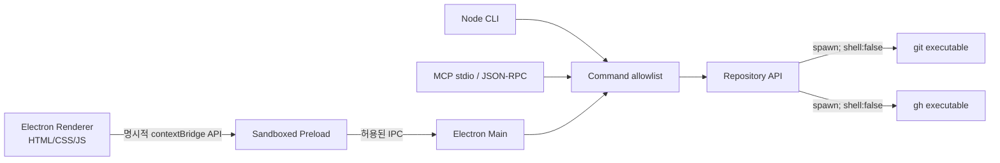

# 🧩 아키텍처 · 한 엔진, 세 출입구

**Raidian v0.2.0 (Electron)** 은 Electron GUI, Node.js CLI, 표준입출력 MCP가 공통 `Repository` 엔진(`src/core/git.cjs`)을 사용합니다. UI에서 Git 명령을 직접 실행하지 않습니다.

## 보안 경계

- `nodeIntegration:false`, `contextIsolation:true`, `sandbox:true`, `webSecurity:true`.
- Renderer는 `window.raidian.{snapshot,chooseFolder,action,openLink,copy}`만 호출할 수 있습니다.
- `src/core/commands.cjs`는 지원된 Git 명령 이름만 허용합니다. 임의 `exec`나 `shell` API를 제공하지 않습니다.
- 외부 URL 열기는 GitHub PR/Issue 링크만 허용합니다. 외부 사이트를 내부 창으로 탐색하지 않습니다.
- 텍스트 출력은 DOM `textContent`로 삽입하여 커밋 메시지가 HTML처럼 동작하지 않습니다.
- 서버 환경에서는 MCP `--allow-write` 없이 쓰기 도구가 공개되지 않고 쓰기 도구 호출마다 `confirm:true`가 있어야 합니다. *이 값은 실제 인간이 승인했음을 암호학적으로 보증하지 않습니다.*
- `merge`는 항상 `--no-ff --no-edit`, `pull`은 `--no-rebase --no-ff`; 강제 푸시/히스토리 재작성은 제공하지 않습니다.
- 브랜치 이동/병합/cherry-pick/revert 전 미커밋 상태를 확인합니다. GUI에서 Git 작업 중 폴더 전환을 막습니다.

## 핵심 모듈

| 경로 | 책임 |
|---|---|
| `src/core/git.cjs` | 안정적인 Git 호출, UTF-8 우선+CP949 폴백, porcelain `-z`, 브랜치/원격/이력 API |
| `src/core/commands.cjs` | 지원 명령 목록·권한·확인 가드·엔진 디스패치 |
| `src/core/cli.cjs` | 플래그 해석과 JSON/대화형 셸 |
| `src/mcp/server.cjs` | 도구 목록·MCP 핸드셰이크·JSON-RPC stdio |
| `src/electron/main.cjs` | 윈도우·권한 제한 IPC·단일 인스턴스·폴더 선택 |
| `src/electron/preload.cjs` | sandbox contextBridge |
| `src/renderer/{index.html,style.css,app.js}` | 조선굴림체·시멘틱 UI·버건디/블러시 반응형 레이아웃 |

## Git 이력과 브랜치 의미

Git에서는 `a` 브랜치와 `a/b` 브랜치가 동시에 존재할 수 없습니다. `/` 경로가 실제 부모 관계는 아니며 새 브랜치의 **출발 커밋**이 분기 관계를 결정합니다. Raidian의 `branch-child`는 `chatgpt-extrahigh/group/detail` 형태이며 UI에서 시작 브랜치를 지정할 수 있습니다.

`revert`는 이력을 삭제하지 않습니다. 특정 커밋의 변경만 반대로 적용하는 새 커밋을 만듭니다. 머지 커밋을 되돌리는 등 복잡한 경우 Git 자체 에러를 보여주고 사용자에게 수동 처리를 맡깁니다.

## 데이터·인코딩

상태 조회는 `git status --porcelain=v1 -z`로 처리합니다. 한글 공백·따옴표·개행이 포함된 파일명도 Git이 NUL 분리로 전송하므로 텍스트 이스케이프에 의존하지 않습니다. 명령 프로세스 출력을 먼저 UTF-8로 복호화하고 유효하지 않은 바이트가 감지될 때 CP949(EUC-KR) 디코더를 사용합니다.

## 배포 경계

Electron Builder `portable`과 `zip` Windows x64 타깃. EXE에는 Chromium/Node 런타임이 포함되지만 **Git 및 선택적인 gh는 사용자 PC에 따로 필요**합니다. Windows 바이너리 검증이 끝나기 전 GitHub Release를 자동으로 게시하지 않습니다. [BUILD_WINDOWS.md](BUILD_WINDOWS.md)
